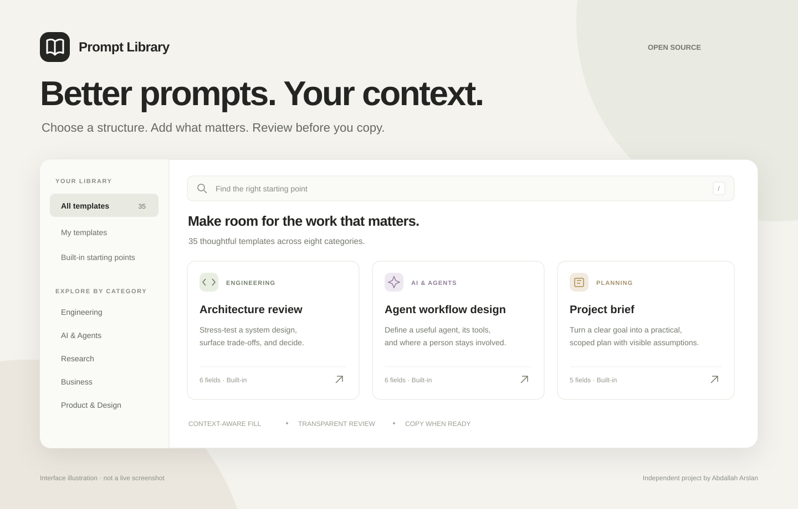

# Prompt Library

Prompt Library is intended only for adults aged 18 or older. The eligibility notice does not technically verify age.

### A better starting point. A prompt you can inspect.

Browse reusable templates, fill relevant details from your conversation, and review every field before copying the final prompt.

[](CHANGELOG.md)
[](LICENSE)
[](docs/architecture.md#review-and-copy)

**35 built-in templates · 8 categories · 9 MCP tools**

Version 2 returns paginated catalog summaries. Open a selected template for its body and fields. The UI labels partial results and can load every saved template. The separate Demo workspace uses fictional records under the same authenticated identity.



*Interface illustration · not a live screenshot.*

## From idea to ready-to-copy

1. **Choose a starting point.** Search the catalog, filter by category, or open one of your saved templates.
2. **Fill deliberately.** Choose **Fill missing fields** to use relevant context the host model can actually see. Choose **Revise with latest context** when existing details need to change.
3. **Review the details.** Explicit facts, inferences, and missing fields stay visible. Edit values and save the draft.
4. **Copy when ready.** The app checks the saved version before copying. It never runs or submits the completed prompt.

Engineering, AI & Agents, Research, Business, Product & Design, Writing, Planning, and Thinking are included. You can also create your own templates or preview a plain-text or JSON import before saving it.

## Designed for a visible handoff

- **Context stays selective.** The host model passes named field values, not a full conversation transcript. The server cannot read chat history independently.
- **Rendering stays predictable.** The server performs single-pass placeholder substitution. Unknown values remain visible as `{{placeholders}}`.
- **Assumptions stay reviewable.** Inferred values require a brief explanation. Source labels describe how a value was supplied; they are not independent fact verification.
- **Drafts stay stable.** Each draft keeps a template snapshot. Version checks protect against silently overwriting a newer draft.
- **User records stay owner-scoped.** Templates and drafts are stored in D1 and queried using a platform-authenticated owner identity.
- **Data controls are explicit.** Source v1.2.0 adds paginated exports and typed-confirmation deletion of the authenticated user’s active library data.

## Developer map

| Component | Source |
| --- | --- |
| Templates, placeholders, deterministic rendering | [`lib/prompt-core.ts`](lib/prompt-core.ts), [`lib/extra-templates.ts`](lib/extra-templates.ts) |
| Validation, storage, owner checks | [`lib/library-service.ts`](lib/library-service.ts) |
| Tool contracts and annotations | [`lib/tool-definitions.ts`](lib/tool-definitions.ts) |
| Interactive MCP App | [`lib/library-ui.ts`](lib/library-ui.ts) |
| JSON-RPC endpoint | [`app/mcp/route.ts`](app/mcp/route.ts) |
| Schema and regression tests | [`db/schema.ts`](db/schema.ts), [`tests/library.test.ts`](tests/library.test.ts) |

The application uses TypeScript, React, Vinext/Vite, MCP Apps, and Cloudflare D1. The inline library uses host-proxied tool calls; the website is a connection guide.

### Verification

Use Node.js 22.13 or newer (Node 24 recommended). From a clean checkout:

```sh
npm ci --ignore-scripts
npm run check
npm run build
```

Configure operator-selected usage limits before enabling library tools, as described in [setup](docs/setup.md#usage-limits). Missing limits fail closed; they have no implicit production defaults.

The service tests use fictional fixtures and an in-memory SQLite adapter. They do not validate a live ChatGPT connection or production D1 deployment. See [setup and local smoke testing](docs/setup.md) and [review cases and evidence](docs/review-cases.md).

### Hosting boundary

This source was built for a platform-managed Sites environment. An independent deployment must supply its own D1 binding and a verified authentication boundary. Never expose an endpoint that trusts a client-supplied owner header. A source checkout alone does not provision hosting, OAuth, a plugin installation, or production storage. See [architecture and trust boundaries](docs/architecture.md).

## Documentation

- [Setup](docs/setup.md): reproducible checks, local storage, and source packaging
- [Security](SECURITY.md): deployment trust boundary and data handling
- [Architecture](docs/architecture.md): tools, data flow, boundaries, and limitations
- [Demo walkthrough](docs/demo-walkthrough.md): a recording script, not a recorded demo
- [Review cases](docs/review-cases.md): five positive and three unsupported-request cases
- [Contributing](CONTRIBUTING.md) · [Changelog](CHANGELOG.md)

This is v2.0.0 source-release and directory-submission preparation. A public ChatGPT directory listing is not yet available. Data controls must be verified in each intended deployment and submission host before being described as available there. Public source availability is separate from plugin submission, approval, and directory availability. These documents do not claim a public listing or review approval.

## License

[MIT](LICENSE) · Copyright 2026 Abdallah Arslan.
